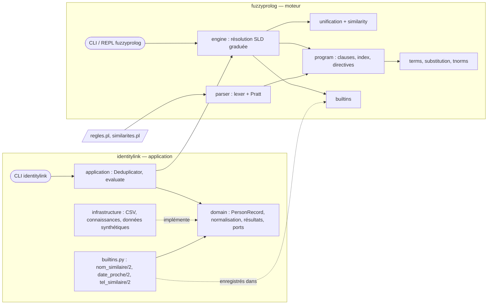
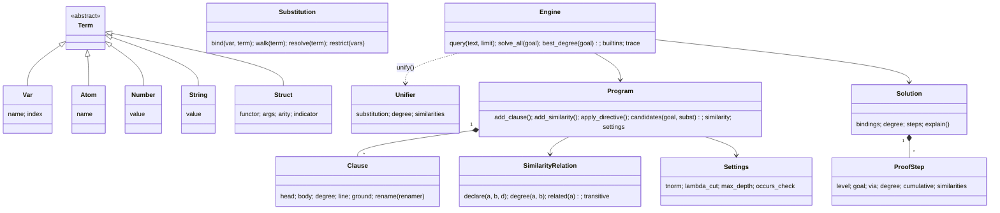
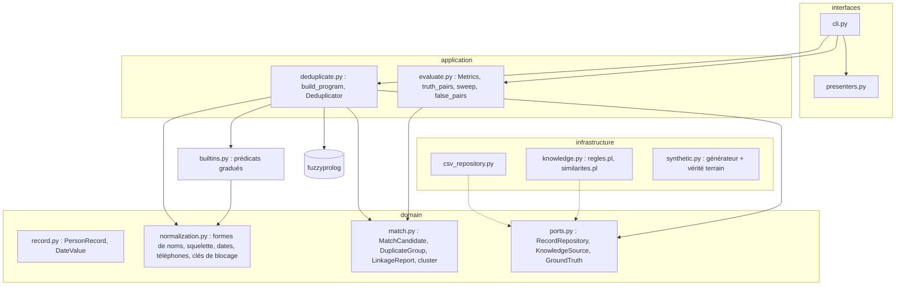

# 3. Architecture

## 3.1 Vue d'ensemble



| Paquet | Rôle | Dépendances |
|---|---|---|
| `fuzzyprolog` | Moteur de programmation logique floue, langage, REPL | bibliothèque standard uniquement |
| `identitylink` | Rapprochement d'identités : domaine, cas d'utilisation, adaptateurs, CLI | `fuzzyprolog` |

## 3.2 Le moteur `fuzzyprolog`

### Modules (ordre de dépendance)

```
terms ─► substitution ─► similarity ─► unification ─► program ─► engine ─► cli
   │          │              tnorms ─────┘              ▲           │
   └── operators ─► parser/{lexer, parser} ─► loader ───┘        solution
                                              builtins ◄─────────┘
```

| Module | Responsabilité | Notion du cours |
|---|---|---|
| `terms` | AST des termes, listes, rendu Prolog | termes, atomes (p. 41-42) |
| `operators` | table des opérateurs (priorités, types) | — |
| `substitution` | substitutions immuables, renommage | σ, θ (p. 54, 60) |
| `similarity` | relation de similarité, fermeture max-min | — (extension) |
| `tnorms` | t-normes min / produit / Łukasiewicz | — (extension) |
| `unification` | unificateur le plus général, occurs check, degrés | algorithme p. 56 |
| `program` | clauses graduées, index par premier argument, directives | clauses de Horn (p. 75) |
| `parser` | lexer + analyseur à précédence d'opérateurs | syntaxe Prolog |
| `loader` | fichiers → programme, prélude du cours | — |
| `builtins` | prédicats prédéfinis (crisp et gradués), registre extensible | `is`, comparaisons |
| `engine` | résolution SLD graduée, coupe, négation, λ-coupure, trace | raisonnement (p. 79-83) |
| `solution` | réponses et preuves | preuve (p. 45) |
| `cli` | exécution de requêtes, REPL | questions (p. 73) |

### Diagramme de classes



### Séquence d'une résolution

```mermaid
sequenceDiagram
    participant U as Utilisateur
    participant E as Engine
    participant P as Program
    participant Un as unify()
    U->>E: query("doublon(A, B).")
    E->>P: candidates(doublon(A,B))
    P-->>E: clauses indexées (1er argument + constantes similaires)
    loop pour chaque clause candidate
        E->>E: renommage θ (Renamer)
        E->>Un: unify(but, tête θ, σ, similarité, t-norme)
        Un-->>E: Unifier(σ', degré) ou échec
        E->>E: degré ← T(degré, degré(σ'), degré(clause)) ; λ-coupure
        E->>E: empiler le corps (barrière de coupe, niveau+1) devant le reste
        E-->>U: Solution(bindings, degré, preuve) à chaque succès (générateur)
    end
```

Chaque appel récursif à `_solve` est un **point de choix** (générateur Python) : reprendre le
générateur, c'est revenir en arrière (*backtracking*, p. 80). Un `_CutDone(barrière)` remonte
les générateurs jusqu'à la clause propriétaire de la coupe, qui abandonne ses alternatives.

## 3.3 L'application `identitylink`



**Règle de dépendance** : `domain` n'importe que `fuzzyprolog` (bibliothèque pure) ;
`application` importe `domain` et `fuzzyprolog` ; `infrastructure` et `interfaces` importent
l'intérieur ; la CLI est la racine de composition.

**Flux d'un dédoublonnage** :

1. lecture des fiches (CSV → `PersonRecord`, dates `DateValue`) ;
2. construction du programme : prélude + `regles.pl` + `similarites.pl` + faits `fiche/6` et
   `bloc/2` (clés de blocage calculées par le domaine) ;
3. requête `meme_personne(A, B)` **sans trace** ; agrégation par paire (meilleur degré) ;
4. re-preuve **avec trace** des seules paires retenues (explications) ;
5. seuil → paires rapprochées → groupes (union-find) → rapport.

## 3.4 Principes de conception

| Principe | Application |
|---|---|
| **S**RP | un module par étape du raisonnement (unification, programme, résolution, preuve) ; dans l'application, normalisation / décision / évaluation / présentation séparées |
| **O**CP | prédéfinis enregistrés dans un registre (`register`) : l'application ajoute `nom_similaire/2` sans toucher au moteur ; t-normes et directives extensibles ; règles et similarités en fichiers `.pl` |
| **L**SP | tout `Term` se rend, s'unifie et se substitue ; toute `TNorm` est un opérateur binaire sur `[0,1]` |
| **I**SP | ports minimaux (`RecordRepository.all`, `KnowledgeSource.rules/similarities`, `GroundTruth.person_of`) ; `TNorm`, `Builtin` sont des protocoles à une fonction |
| **D**IP | `Deduplicator` reçoit un `KnowledgeSource` ; les tests injectent des fiches en mémoire |
| DRY | la table des opérateurs sert au parseur **et** au rendu ; les formes de noms servent aux clés de blocage **et** à la similarité ; prélude unique pour les listes |
| Immutabilité | termes, substitutions, clauses, résultats : `dataclass(frozen=True)` ; le backtracking n'a rien à défaire |
| Fail fast | erreurs de syntaxe avec ligne/colonne, directives inconnues, degrés hors `]0,1]`, prédicat inconnu, profondeur maximale |

## 3.5 Scalabilité

- **Indexation sur les deux premiers arguments** : `fiche(p0118, …)` et `bloc(K, p0118)` sont
  retrouvés en O(1) (le premier argument lié sélectionne l'index) ; l'index s'élargit aux
  constantes *similaires* uniquement (`SimilarityRelation.related`), ce qui préserve
  l'unification faible sans balayage.
- **Blocage** : `candidat/2` ne compare que les fiches partageant une clé (squelette du nom,
  téléphone, courriel) : O(Σ taille des blocs²) au lieu de O(n²).
- **Deux passes** : la trace de preuve (liste chaînée persistante) n'est calculée que pour les
  paires retenues, re-prouvées par un but structurel (pas de passage par le texte).
- **Clauses sans variable** : les faits ne sont pas renommés.
- Mesuré : 257 fiches → 113 paires candidates en ≈ 5 s (Python pur, trace comprise). Pour des volumes plus
  grands : affiner les clés de blocage, paralléliser par bloc, ou compiler les faits dans une
  base indexée.

Limite connue : la profondeur de résolution est bornée (1 000 étapes par défaut) par la pile
Python ; au-delà, `DepthLimitError` est levée proprement (voir ADR-002).

## 3.6 Décisions

Voir `docs/adr/` : moteur maison vs Prolog existant (ADR-001), résolution par générateurs
(ADR-002), unification faible limitée aux constantes (ADR-003), blocage et deux passes
(ADR-004), règles en fichiers Prolog + prédéfinis gradués comme frontière (ADR-005).
