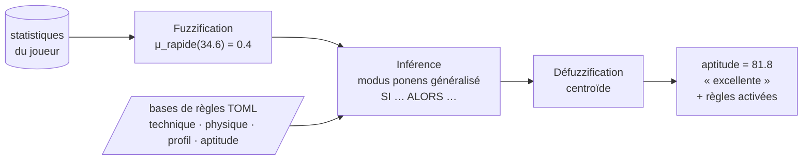

# Fuzzy Scouting — aide à la décision pour le recrutement de joueurs par logique floue

[](https://www.python.org/)
[](docs/09-qualite-et-tests.md)
[](docs/09-qualite-et-tests.md)
[](pyproject.toml)
[](LICENSE)

Projet d'**intelligence artificielle symbolique** (ILISI 3, FSTM) : un système expert flou qui
évalue et classe des joueurs de football pour un poste donné, à partir de leurs statistiques et de
règles rédigées en langage quasi naturel, **en expliquant chaque verdict**. Il se compose d'un
moteur d'inférence floue générique (`fuzzyengine`), de l'application de scouting (`fuzzyscout`,
interface web + CLI + API HTTP) et d'une seconde application démontrant la généricité du moteur sur un problème
d'économie d'eau (`fuzzyirrigation`).

Le projet prolonge le cours *Programmation logique* (logique des propositions, systèmes formels,
logique des prédicats, Prolog) vers la logique floue : chaque notion du cours — interprétation,
formule bien formée, modus ponens, clause de Horn, système formel — a sa contrepartie graduée dans
le code. Voir [docs/02-fondements-theoriques.md](docs/02-fondements-theoriques.md).

## Le problème résolu

Une cellule de recrutement doit présélectionner, parmi des centaines de joueurs, ceux qui
conviennent à un poste, sous contraintes de budget et d'âge. Les critères des recruteurs sont
**vagues** (« rapide », « bon dans les airs », « jeune et déjà titulaire ») et se combinent en
règles d'expertise. Les tableurs figent des seuils arbitraires ; les modèles statistiques
n'expliquent pas leurs sorties. La logique floue formalise exactement ce raisonnement : des
prédicats gradués, des règles `SI … ALORS …`, et une conclusion accompagnée de la liste des règles
qui l'ont produite. Détails : [docs/01-probleme-et-objectifs.md](docs/01-probleme-et-objectifs.md).

## Démarrage rapide

Le plus simple — un lanceur installe le projet au premier appel (environnement virtuel compris),
démarre le serveur et ouvre l'interface web dans le navigateur :

```bash
scout                  # Windows (invite de commandes ou double-clic sur scout.cmd) ; PowerShell : .\scout
./scout.sh             # Linux / macOS
```

| Commande | Effet |
|---|---|
| `scout` ou `scout web` | Interface web sur <http://127.0.0.1:8000> (`-Port 8080` pour changer de port, `-NoBrowser` pour ne pas ouvrir le navigateur ; sous Linux/macOS : `PORT=8080`, `NO_BROWSER=1`) |
| `scout setup` | Crée `.venv` et installe le projet avec ses dépendances |
| `scout test` | Lance les tests |
| `scout check` | Porte qualité : format, lint, typage strict, tests |
| `scout demo` | Classement de démonstration dans le terminal |

Ou pas à pas :

```bash
# 1. Environnement (Python >= 3.11)
python -m venv .venv
.venv\Scripts\activate            # Windows   |   source .venv/bin/activate (Linux/macOS)
pip install -e ".[api,dev]"       # le cœur n'a aucune dépendance ; [api] = FastAPI, [dev] = outils

# 2. Vérifier les bases de connaissances et lister les postes
fuzzyscout validate
fuzzyscout positions

# 3. Classer les attaquants du jeu de données d'exemple (40 joueurs synthétiques)
fuzzyscout rank --position attaquant --top 5 --min-minutes 900

# 4. Évaluer un joueur avec l'explication complète
fuzzyscout evaluate --position attaquant --player P036 --explain

# 5. Évaluer un candidat absent du fichier (analyse « et si »)
fuzzyscout evaluate --position gardien --attr arrets_pct=76 --attr buts_encaisses_p90=0.9 \
  --attr precision_passes_pct=80 --attr taille_cm=191 --attr sorties_aeriennes_p90=1.6 \
  --attr age=27 --attr minutes_jouees=3000 --attr blessures_jours=4

# 6. Interface web sur http://127.0.0.1:8000 (API documentée sur /docs)
fuzzyscout serve

# 7. Seconde application : contrôleur d'irrigation
fuzzyirrigation decide --humidite-sol 18 --temperature 34 --humidite-air 28 --explain
```

Exemple de sortie (`rank`) :

```
Classement — Attaquant de pointe (attaquant)
Candidats : 40 | classés : 8 | exclus : 7
Filtres : minutes ≥ 900

  #  id     nom                    club                   poste        âge     M€   apt.  label       tech  phys  prof
  1  P040   Walid Hajji            Union Chaouia          attaquant     25   28.1   83.2  excellente  81.6  59.8  87.6
  2  P036   Rachid Haddad          Racing Sahara          attaquant     20   45.0   81.8  excellente  80.6  79.4  82.1
  3  P035   Elias Slaoui           Olympique du Détroit   attaquant     24   19.7   77.6  bonne       77.1  55.3  70.0
  ...
Exclus :
  - Jonas Tazi [P001] : statistiques manquantes : buts_p90, xg_p90, ...
  - Malik Dubois [P022] : temps de jeu 562 min < 900
```

Exemple d'explication (`evaluate --explain`, extrait) :

```
Rachid Haddad [P036] — Racing Sahara — attaquant, 20 ans
Aptitude : 81.8/100 (excellente)
Détail : technique=80.6 (excellente) | physique=79.4 (excellente) | profil=82.1 (excellente)
Pourquoi :
  Étape « technique_attaquant »
    buts_p90 = 0.95 -> faible=0.00, moyen=0.00, eleve=1.00
    tirs_cadres_pct = 53.3 -> faible=0.00, moyenne=0.00, bonne=0.57
    - [T1] force=0.57 : SI buts_p90 EST eleve ET tirs_cadres_pct EST bonne ALORS technique EST excellente
    - [T2] force=0.43 : SI buts_p90 EST eleve ET tirs_cadres_pct N'EST PAS bonne ALORS technique EST bonne
    => technique = 80.6 (excellente)
  ...
```

## Interface web

`fuzzyscout serve` démarre l'API **et** une interface web pour l'entraîneur ou la cellule de
recrutement, sur <http://127.0.0.1:8000>. Elle est écrite en HTML/CSS/JavaScript sans dépendance ni
étape de build, et ne contient aucune logique floue : tout est calculé par l'API.

| Écran | Usage |
|---|---|
| **Recherche** | Choisir un poste, poser les contraintes (budget, âge, temps de jeu, nationalité, poste naturel) ; classement trié par aptitude, liste des exclus avec la raison |
| **Fiche joueur** | Aptitude et notes technique / physique / profil, puis *pourquoi* : courbes d'appartenance avec la valeur du joueur, degrés obtenus, règles déclenchées et leur force |
| **Comparer** | Jusqu'à trois joueurs côte à côte au même poste (notes et statistiques utilisées par les règles) |
| **Simulateur** | Curseurs « et si… ? » : évaluer un candidat hors référentiel ou modifier les statistiques d'un joueur, verdict recalculé en direct |
| **Règles** | Base de connaissances d'un poste en clair (étapes, règles, poids) et vocabulaire flou (courbes de chaque terme) |
| **Sélection** | Liste de joueurs retenus (conservée dans le navigateur), export CSV |

## Comment ça marche (en une figure)



Chaque poste est évalué par un **pipeline** de quatre petits systèmes flous (technique spécifique
au poste, physique, profil, puis agrégation) : lisible, extensible et sans explosion combinatoire.

## Structure du dépôt

```
fuzzy-scouting/
├── src/
│   ├── fuzzyengine/         moteur d'inférence floue générique (Python pur)
│   │   ├── membership.py    fonctions d'appartenance        ├── inference.py       Mamdani
│   │   ├── variables.py     termes et variables linguistiques├── defuzzification.py centroïde…
│   │   ├── formulas.py      fbf floues (Atom/Not/And/Or)     ├── system.py          FuzzySystem
│   │   ├── operators.py     t-normes, t-conormes, ¬          ├── pipeline.py        chaînage
│   │   ├── rules.py         règles, base de règles           ├── explanation.py     traces
│   │   ├── dsl/             langage de règles (FR/EN)        └── loaders/           TOML
│   ├── fuzzyscout/          application de scouting (architecture hexagonale)
│   │   ├── domain/          Player, Position, filtres, ports, evaluate_player
│   │   ├── application/     EvaluatePlayer, RankPlayers, ScoutingService
│   │   ├── infrastructure/  dépôt CSV, catalogue et pipelines TOML, adaptateurs mémoire
│   │   ├── interfaces/      cli.py, api/ (FastAPI), web/ (interface web), presenters.py
│   │   ├── knowledge/       variables.toml, positions.toml, technique/ physique/ profil/ aptitude/
│   │   └── data/            joueurs_exemple.csv (synthétique)
│   └── fuzzyirrigation/     seconde application : contrôleur d'irrigation
├── tests/                   165 tests (moteur, scouting, irrigation) — couverture 96 %
├── docs/                    documentation détaillée (voir ci-dessous) + ADR
├── scripts/                 génération du jeu de données, lanceur Windows (scout.ps1)
├── scout.cmd / scout.sh     lanceurs : installation, interface web, tests, porte qualité
├── docker/                  Dockerfile, docker-compose.yml
└── pyproject.toml           paquet, extras, ruff, mypy strict, pytest
```

## Documentation

| Chapitre | Contenu |
|---|---|
| [01 — Problème et objectifs](docs/01-probleme-et-objectifs.md) | Besoin métier, périmètre, critères de succès, pourquoi la logique floue |
| [02 — Fondements théoriques](docs/02-fondements-theoriques.md) | Du cours de logique à la logique floue ; table de correspondance cours ↔ code |
| [03 — Architecture](docs/03-architecture.md) | Diagrammes (paquets, classes, séquences), SOLID/DRY, points d'extension, scalabilité |
| [04 — Moteur fuzzyengine](docs/04-moteur-fuzzyengine.md) | Référence de l'API, grammaire du langage de règles, format TOML, algorithmes |
| [05 — Application scouting](docs/05-application-scouting.md) | Données, variables linguistiques, bases de règles par poste, lecture des rapports |
| [06 — Application irrigation](docs/06-application-irrigation.md) | Seconde application : variables, règles, usage |
| [07 — Guide du développeur](docs/07-guide-developpeur.md) | Installation, commandes, conventions, comment étendre (poste, variable, forme, défuzzifieur…) |
| [08 — Déploiement et exploitation](docs/08-deploiement.md) | CLI, API HTTP, configuration, Docker, journalisation, performances |
| [09 — Qualité et tests](docs/09-qualite-et-tests.md) | Stratégie de test, inventaire, propriétés vérifiées, analyse statique, CI |
| [ADR](docs/adr/) | Décisions d'architecture : cœur sans dépendance, Mamdani, TOML/DSL, hexagonal, pipeline, filtres, 2ᵉ application |
| [Glossaire](docs/glossaire.md) | Vocabulaire de la logique floue et du scouting |

## Principes

- **Alignement avec le cours** : formules bien formées, interprétation, modus ponens et clauses
  de Horn sont implémentés littéralement, puis généralisés à `[0, 1]` ; les propriétés conservées
  (De Morgan, éléments neutres) et perdues (tiers exclu) sont vérifiées par des tests.
- **Clean code** : SOLID (abstractions `MembershipFunction`, `Defuzzifier`, `InferenceMethod`,
  ports `Protocol` ; injection de dépendances ; registres ouverts à l'extension), DRY (bibliothèque
  de variables partagée, étapes communes, présentation unique CLI/API), immutabilité, typage strict.
- **Pré-production** : aucune dépendance pour le cœur, validation des bases au chargement avec
  diagnostics localisés, CLI et API documentées, Docker, journalisation, 96 % de couverture.

## Licence

MIT — voir [LICENSE](LICENSE). Les données de `src/fuzzyscout/data/` sont **synthétiques** ;
noms et clubs sont fictifs.
