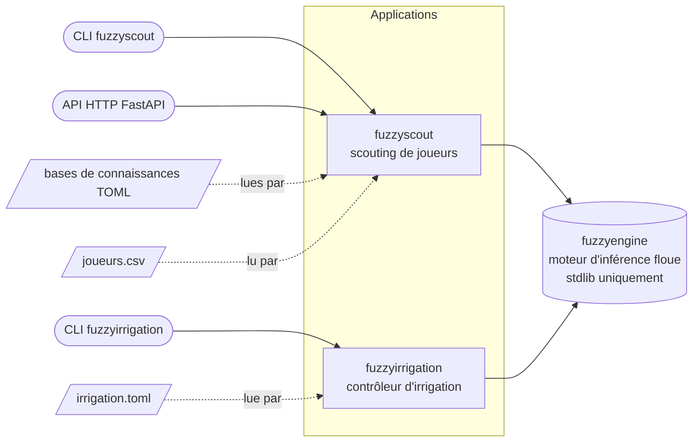
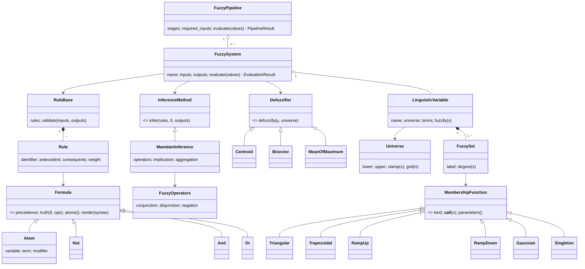
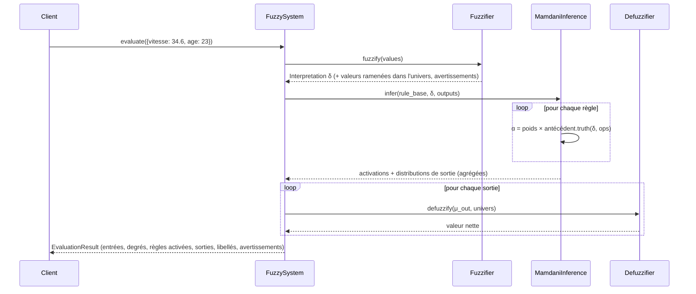
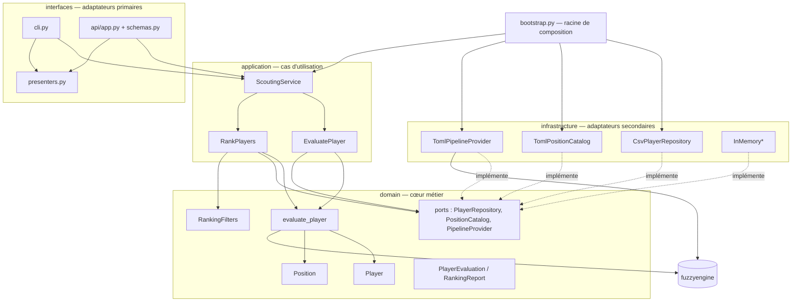
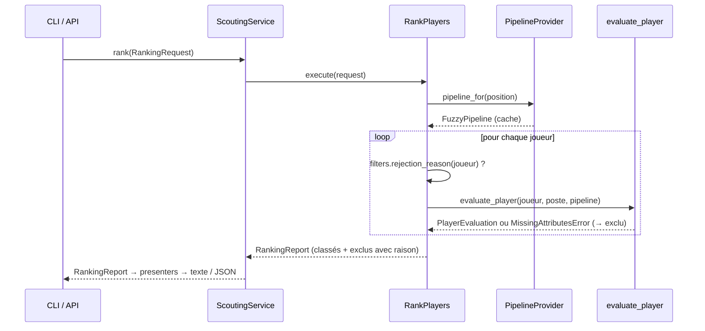

# 3. Architecture

## 3.1 Vue d'ensemble

Le dépôt contient **un moteur générique** et **deux applications** qui l'utilisent. Les flèches
indiquent le sens des dépendances : elles pointent toujours vers l'intérieur (du concret vers
l'abstrait), jamais l'inverse.

| Paquet | Rôle | Dépendances externes |
|---|---|---|
| `fuzzyengine` | Ensembles flous, formules, règles, inférence, défuzzification, langage de règles, chargeur TOML, explications | aucune |
| `fuzzyscout` | Domaine du scouting, cas d'utilisation, adaptateurs CSV/TOML, CLI, API | `fuzzyengine` ; FastAPI/pydantic uniquement pour l'API (extra `[api]`) |
| `fuzzyirrigation` | Domaine de l'irrigation, service, CLI | `fuzzyengine` |

## 3.2 Le moteur `fuzzyengine`

### Modèle de classes

### Séquence d'une évaluation

Les modules sont volontairement petits et alignés sur les étapes de la méthode :
`membership` → `variables` → `fuzzification` → `formulas`/`operators` → `rules` → `inference` →
`defuzzification` → `system` → `pipeline`, plus `dsl` (texte) et `loaders` (fichiers).

## 3.3 L'application `fuzzyscout` : architecture hexagonale

**Règle de dépendance.** `domain` n'importe que `fuzzyengine` (le moteur est une bibliothèque
pure, sans I/O, donc admissible dans le domaine). `application` n'importe que `domain`.
`infrastructure` et `interfaces` importent les couches internes ; elles ne s'importent jamais entre
elles, sauf au point de câblage `bootstrap.py`. Cette règle est vérifiable à la lecture des
`import` de chaque module.

**Ports et adaptateurs.** Les ports sont des `typing.Protocol` (`domain/ports.py`). Un
adaptateur n'a pas besoin d'hériter : il suffit qu'il expose les bonnes méthodes (typage
structurel). Remplacer le CSV par une base SQL ou une API de fournisseur de données = écrire une
classe exposant `all()` et `get(id)` et la brancher dans `bootstrap.py`.

**Séquence d'un classement.**

## 3.4 Principes de conception appliqués

### SOLID

| Principe | Application concrète |
|---|---|
| **S** — responsabilité unique | Chaque module du moteur traite une étape (fuzzification, inférence, défuzzification…). Dans l'application : `RankPlayers` ne fait que classer, `RankingFilters` ne fait que filtrer, `presenters` ne fait que formater. |
| **O** — ouvert/fermé | Nouvelles formes d'appartenance, familles d'opérateurs, défuzzifieurs, méthodes d'inférence : on ajoute une classe et une entrée de registre (`MEMBERSHIP_REGISTRY`, `OPERATOR_FAMILIES`, `DEFUZZIFIERS`) sans modifier l'existant. Nouveau poste = nouveau fichier TOML, aucun code. |
| **L** — substitution de Liskov | Toute `MembershipFunction` renvoie un degré dans `[0,1]` ; tout `Defuzzifier` renvoie une valeur de l'univers ; tout `InferenceMethod` renvoie un `InferenceOutcome`. Les tests du moteur sont écrits contre les abstractions. |
| **I** — ségrégation des interfaces | Trois ports minimaux (`PlayerRepository`, `PositionCatalog`, `PipelineProvider`) au lieu d'une interface « dépôt universel » ; `BinaryOperator`, `UnaryOperator`, `Implication`, `Modifier` sont des protocoles à une méthode. |
| **D** — inversion des dépendances | Les cas d'utilisation reçoivent les ports par injection (dataclasses). Le câblage concret se fait uniquement dans `bootstrap.py` ; les tests injectent des adaptateurs en mémoire. |

### DRY

- Les variables linguistiques sont définies **une fois** dans `knowledge/variables.toml` et
  référencées (`ref = "…"`) par toutes les bases de règles.
- Les étapes `physique`, `profil` et `aptitude` sont **partagées** entre postes.
- Les mots-clés du langage de règles (anglais/français) sont centralisés dans `dsl/syntax.py`,
  utilisés à la fois par l'analyseur et par le rendu.
- La présentation (`presenters.py`) est partagée par la CLI et l'API : un même dictionnaire sert au
  JSON de l'API et au JSON de la CLI ; les explications textuelles réutilisent les blocs
  (`explain_inputs`, `explain_activations`, `explain_conclusions`) du moteur.
- Les deux CLI partagent `fuzzyengine.console.ensure_utf8_console`.
- `evaluate_player` (domaine) est l'unique chemin d'évaluation, utilisé par les deux cas
  d'utilisation.

### Autres principes

- **Immutabilité** : toutes les entités et objets-valeur sont des `dataclass(frozen=True)` ;
  les résultats d'évaluation sont des instantanés non modifiables, sûrs à partager.
- **Fail fast** : une base de connaissances invalide (terme inconnu, poids hors `]0,1]`, univers
  dégénéré) est rejetée au chargement avec un message localisant la faute (`[fichier.rules[3]] …`).
- **Explicabilité par construction** : chaque résultat porte la trace complète (degrés
  d'entrée, règles activées et leur force, lecture linguistique de la sortie).

## 3.5 Points d'extension

| Besoin | Où intervenir | Code à toucher |
|---|---|---|
| Nouveau poste | `knowledge/positions.toml` (+ `technique/<poste>.toml`) | aucun |
| Nouvelle statistique | `knowledge/variables.toml` + colonne CSV | aucun |
| Ajuster des seuils / règles | fichiers TOML | aucun |
| Nouvelle forme d'appartenance | sous-classe de `MembershipFunction` + registre | 1 classe |
| Nouvelle défuzzification | sous-classe de `Defuzzifier` + registre | 1 classe |
| Inférence de Sugeno | implémenter `InferenceMethod` | 1 classe |
| Source de données SQL / API | adaptateur `PlayerRepository` + `bootstrap.py` | 1 classe + 1 ligne |
| Nouvelle interface (bot, tableau de bord) | nouveau module dans `interfaces/` utilisant `ScoutingService` et `presenters` | 1 module |
| Nouveau domaine métier | nouveau paquet sur le modèle de `fuzzyirrigation` | KB + domaine mince |

## 3.6 Scalabilité et performance

- **Explosion combinatoire maîtrisée** : avec 14 statistiques à 3 termes, un système plat
  exigerait jusqu'à `3¹⁴` règles. Le **pipeline hiérarchique** (`technique`, `physique`, `profil`
  → `aptitude`) ramène cela à 4 petits systèmes de 8 à 16 règles, lisibles et maintenables par un
  expert métier (voir `ADR-005`).
- **Coût d'une évaluation** : `O(R · A + O · N · R)` avec `R` règles, `A` atomes par règle, `O`
  sorties, `N` points de défuzzification (501 par défaut). Mesuré : environ 4 à 5 ms par joueur et
  par poste en Python pur (4 étapes), soit un classement de 1 000 joueurs en moins de dix
  secondes ; la résolution est configurable par base (`resolution = 201`).
- **Sans état** : les pipelines sont immuables et mis en cache par poste ; l'API est sans session,
  donc réplicable horizontalement derrière un équilibreur de charge.
- **Traitement par lots** : `RankPlayers` est une boucle indépendante par joueur, parallélisable
  (multiprocessing) sans changement de l'interface.

## 3.7 Décisions d'architecture

Les choix structurants sont consignés dans `docs/adr/` (format *Architecture Decision Record*) :
cœur sans dépendance, inférence de Mamdani en chaînage avant, bases de connaissances TOML et DSL
bilingue, architecture hexagonale, pipeline hiérarchique, filtres nets vs préférences floues,
seconde application.
