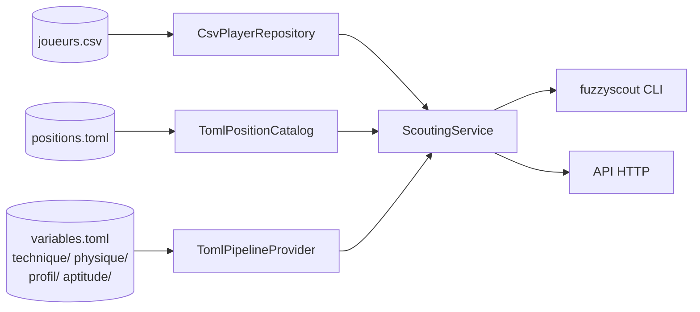

# 5. Application de scouting `fuzzyscout`

## 5.1 Vue d'ensemble



Pour un poste, le service charge un **pipeline** de quatre systèmes flous et l'applique aux
statistiques de chaque joueur. Les contraintes nettes (budget, âge…) sont appliquées **avant**
l'inférence et produisent des exclusions motivées.

## 5.2 Modèle du domaine

| Objet | Rôle | Invariants |
|---|---|---|
| `Player` | Identité (`id`, `nom`, `club`, `nationalite`, `poste` naturel) + `attributes` : dictionnaire immuable des statistiques mesurées | `id` et `nom` non vides ; les attributs sont des réels |
| `Position` | `code`, `label`, `description`, `stages` : fichiers TOML chaînés | au moins une étape |
| `RankingFilters` | Contraintes nettes : `max_age`, `max_market_value`, `min_minutes`, `natural_position_only`, `nationality` | `rejection_reason(player, position)` renvoie la raison ou `None` |
| `PlayerEvaluation` | Résultat : scores intermédiaires et final, libellés, trace complète (`PipelineResult`) | `aptitude` = sortie de la dernière étape |
| `RankingReport` | Entrées classées (`rank`, évaluation) + joueurs exclus avec raison + filtres appliqués | ordre décroissant d'aptitude, puis nom |
| Ports | `PlayerRepository`, `PositionCatalog`, `PipelineProvider` (`Protocol`) | implémentés par l'infrastructure |

Service de domaine `evaluate_player(player, position, pipeline)` : vérifie la présence des
statistiques requises (`MissingAttributesError` sinon), exécute le pipeline et construit la
`PlayerEvaluation`. Les deux cas d'utilisation (`EvaluatePlayer`, `RankPlayers`) passent par lui.

## 5.3 Format des données d'entrée (CSV)

Colonnes d'identité : `id` et `nom` (obligatoires), `club`, `nationalite`, `poste` (facultatives).
Toute autre colonne est une statistique numérique ; une cellule vide signifie « non mesurée ».
Séparateur `,` ou `;`, virgule décimale acceptée, BOM UTF-8 toléré (exports Excel).

| Colonne | Unité | Univers | Utilisée par |
|---|---|---|---|
| `age` | ans | 16-40 | profil |
| `taille_cm` | cm | 160-205 | physique |
| `minutes_jouees` | min | 0-4000 | profil, filtre `--min-minutes` |
| `blessures_jours` | jours | 0-200 | profil |
| `valeur_marche_meur` | M€ | — | filtre `--max-value` |
| `contrat_mois_restants` | mois | — | information |
| `buts_p90`, `xg_p90` | /90 | 0-1,5 | attaquant, ailier |
| `passes_decisives_p90` | /90 | 0-1 | ailier |
| `tirs_cadres_pct` | % | 0-100 | attaquant |
| `passes_cles_p90` | /90 | 0-4 | attaquant, milieu |
| `precision_passes_pct` | % | 50-100 | milieu, défenseur, gardien |
| `passes_progressives_p90` | /90 | 0-12 | milieu |
| `dribbles_p90`, `dribbles_reussis_pct` | /90, % | 0-8, 0-100 | ailier |
| `tacles_p90`, `interceptions_p90` | /90 | 0-6, 0-5 | défenseur, milieu |
| `duels_aeriens_pct` | % | 0-100 | défenseur, physique |
| `vitesse_max_kmh`, `distance_km_p90` | km/h, km | 25-38, 7-14 | physique (joueurs de champ) |
| `arrets_pct`, `buts_encaisses_p90`, `sorties_aeriennes_p90` | %, /90, /90 | 50-90, 0-3, 0-3 | gardien |

Les valeurs hors univers sont ramenées à la borne avec un avertissement conservé dans le rapport.

**Jeu de données de démonstration** : `src/fuzzyscout/data/joueurs_exemple.csv`, 40 joueurs
**synthétiques** (noms et clubs fictifs) générés par `scripts/generate_sample_players.py` avec une
graine fixe ; chaque joueur a un facteur de qualité caché, ce qui permet de vérifier que le système
retrouve les meilleurs profils.

## 5.4 Postes et pipelines

| Poste (`code`) | Étape technique | Étape physique | Étape profil | Agrégation |
|---|---|---|---|---|
| `gardien` | `technique/gardien` : arrêts, buts encaissés, jeu au pied | `physique/gardien` : taille, sorties aériennes | `profil/commun` | `aptitude/commun` |
| `defenseur_central` | `technique/defenseur_central` : duels aériens, interceptions, tacles, relance | `physique/joueur_de_champ` | idem | idem |
| `milieu_central` | `technique/milieu_central` : précision, passes progressives, passes clés, interceptions | idem | idem | idem |
| `ailier` | `technique/ailier` : dribbles tentés/réussis, passes décisives, buts | idem | idem | idem |
| `attaquant` | `technique/attaquant` : buts, xG, tirs cadrés, passes clés | idem | idem | idem |

Chaque étape produit un score sur `[0, 100]` lu avec les mêmes termes :
`faible` (trapèze 0-0-25-45), `moyenne` (triangle 30-50-70), `bonne` (triangle 55-70-85),
`excellente` (trapèze 72-88-100-100). Le catalogue (`positions.toml`) est la seule chose à éditer
pour ajouter un poste (plus, si besoin, une étape technique dédiée).

## 5.5 Variables linguistiques

Toutes les variables sont définies une fois dans `knowledge/variables.toml`. Exemples de
découpages (rampes = épaules, triangles = termes centraux) :

| Variable | Termes et seuils |
|---|---|
| `age` | jeune ↘ 22-25 · prime △ 23-28-32 · veteran ↗ 30-33 |
| `buts_p90` | faible ↘ 0,15-0,35 · moyen △ 0,25-0,45-0,65 · eleve ↗ 0,55-0,80 |
| `tirs_cadres_pct` | faible ↘ 28-38 · moyenne △ 33-43-53 · bonne ↗ 47-58 |
| `precision_passes_pct` | faible ↘ 72-78 · moyenne △ 75-82-88 · bonne ↗ 85-90 |
| `duels_aeriens_pct` | faible ↘ 42-50 · moyen △ 46-55-64 · eleve ↗ 60-68 |
| `vitesse_max_kmh` | lente ↘ 30-32 · moyenne △ 31-33-35 · rapide ↗ 34-35,5 |
| `minutes_jouees` | faible ↘ 800-1500 · moyen △ 1200-2000-2800 · eleve ↗ 2400-3000 |
| `blessures_jours` | faible ↘ 15-35 · moyen △ 25-55-90 · eleve ↗ 75-110 |
| `arrets_pct` | faible ↘ 64-69 · moyen △ 66-71-76 · eleve ↗ 74-78 |

(↘ `ramp_down(a, b)` : 1 avant *a*, 0 après *b* ; △ `triangle(a, b, c)` ; ↗ `ramp_up(a, b)`.)
Les termes adjacents se recouvrent, de sorte que toute valeur appartient à au moins un terme avec
un degré non nul : c'est la condition de **couverture** vérifiée par les tests.

## 5.6 Bases de règles

Chaque base compte 8 à 16 règles : des règles « expertes » à plusieurs antécédents, puis des
**règles de couverture** à faible poids (0,4-0,5) qui garantissent une conclusion en tout point.
Les descriptions sont reprises dans les explications.

### `technique/attaquant` (13 règles)

```
T1  SI buts_p90 EST eleve ET tirs_cadres_pct EST bonne            ALORS technique EST excellente   (buteur prolifique et adroit)
T2  SI buts_p90 EST eleve ET tirs_cadres_pct N'EST PAS bonne      ALORS technique EST bonne        (efficace malgré une adresse perfectible)
T3  SI buts_p90 EST eleve ET passes_cles_p90 EST eleve            ALORS technique EST excellente   (buteur complet)
T4  SI buts_p90 EST moyen ET xg_p90 EST eleve                     ALORS technique EST bonne        (beaucoup d'occasions, finition à confirmer)
T5  SI buts_p90 EST moyen ET tirs_cadres_pct EST bonne ET passes_cles_p90 EST eleve ALORS technique EST bonne
T6  SI buts_p90 EST moyen ET xg_p90 EST moyen                     ALORS technique EST moyenne
T7  SI buts_p90 EST moyen ET xg_p90 EST faible ET passes_cles_p90 EST faible ALORS technique EST moyenne   [0.8]
T8  SI buts_p90 EST faible ET xg_p90 EST eleve                    ALORS technique EST moyenne      (sous-performe ses xG)
T9  SI buts_p90 EST faible ET passes_cles_p90 EST eleve           ALORS technique EST moyenne      [0.8]
T10 SI buts_p90 EST faible ET xg_p90 EST faible                   ALORS technique EST faible
T11 SI buts_p90 EST faible ET tirs_cadres_pct EST faible          ALORS technique EST faible
T12 SI buts_p90 EST moyen                                         ALORS technique EST moyenne      [0.5] couverture
T13 SI buts_p90 EST faible                                        ALORS technique EST faible       [0.5] couverture
```

### `aptitude/commun` (16 règles) — la technique domine, physique et profil modulent

```
S1  SI technique EST excellente ET physique N'EST PAS faible ET profil N'EST PAS faible ALORS aptitude EST excellente
S2  SI technique EST excellente ET physique EST faible          ALORS aptitude EST bonne      (talent limité par l'athlétisme)
S3  SI technique EST excellente ET profil EST faible            ALORS aptitude EST bonne      (risque âge / blessures / temps de jeu)
S4  SI technique EST bonne ET physique EST excellente ET profil N'EST PAS faible ALORS aptitude EST excellente [0.9]
S5  SI technique EST bonne ET profil EST excellente ET physique N'EST PAS faible ALORS aptitude EST excellente [0.7]
S6  SI technique EST bonne ET physique EST bonne                ALORS aptitude EST bonne
S7  SI technique EST bonne ET physique EST moyenne              ALORS aptitude EST bonne      [0.8]
S8  SI technique EST bonne ET physique EST faible               ALORS aptitude EST moyenne
S9  SI technique EST bonne ET profil EST faible ET physique N'EST PAS excellente ALORS aptitude EST moyenne [0.8]
S10 SI technique EST moyenne ET physique EST excellente ET profil EST excellente ALORS aptitude EST bonne
S11 SI technique EST moyenne ET physique EST bonne ET profil EST bonne ALORS aptitude EST bonne [0.6]
S12 SI technique EST moyenne ET physique N'EST PAS faible       ALORS aptitude EST moyenne
S13 SI technique EST moyenne ET physique EST faible             ALORS aptitude EST faible     [0.8]
S14 SI technique EST faible                                     ALORS aptitude EST faible
S15 SI profil EST faible ET physique EST faible ET technique N'EST PAS excellente ALORS aptitude EST faible
S16 SI technique EST bonne ET physique EST excellente ET profil EST faible ALORS aptitude EST bonne
```

### Autres bases (résumé)

| Base | Règles | Idée directrice |
|---|---|---|
| `technique/ailier` | 13 | Percussion (volume × réussite des dribbles) et contribution décisive (passes décisives, buts) ; « tente beaucoup, réussit peu » est pénalisé |
| `technique/milieu_central` | 12 | Sécurité (précision) × projection (passes progressives) ; création (passes clés) et récupération (interceptions) valorisées ; « sûr mais sans projection » = moyen |
| `technique/defenseur_central` | 14 | Domination aérienne × lecture du jeu (interceptions, tacles) ; la relance (précision) est un bonus |
| `technique/gardien` | 11 | Taux d'arrêts × buts encaissés (un gardien très sollicité derrière une défense exposée n'est pas pénalisé outre mesure) ; jeu au pied en bonus |
| `physique/joueur_de_champ` | 12 | Vitesse de pointe × volume de course ; présence aérienne et taille en complément |
| `physique/gardien` | 8 | Taille × sorties aériennes |
| `profil/commun` | 12 | Jeune titulaire disponible = excellent ; vétéran peu utilisé ou blessé = faible ; blessures lourdes = faible quel que soit l'âge |

Le texte intégral de chaque règle est dans `src/fuzzyscout/knowledge/`, et `fuzzyscout validate`
affiche le nombre de règles et les entrées requises de chaque poste.

## 5.7 Lire un rapport

**Classement** (`fuzzyscout rank --position attaquant --top 5 --min-minutes 900`) : le tableau
donne pour chaque joueur l'aptitude, son libellé et les trois scores intermédiaires, puis la liste
des exclus avec leur raison. Un gardien évalué comme attaquant est exclu pour « statistiques
manquantes » (il n'a pas de `buts_p90`) ; un ailier est évalué (hors poste) et apparaît
généralement avec une technique moyenne : le système ne confond pas « non éligible » et « faible ».

**Évaluation expliquée** (`--explain`) : pour chaque étape, les degrés de chaque statistique dans
chaque terme, puis les règles activées par force décroissante avec leur description, puis la sortie
et sa lecture linguistique. Le JSON (`--json`, API `trace=true`) contient les mêmes informations
avec en plus les degrés de chaque atome de chaque règle.

**Évaluation ad hoc** (`--attr nom=valeur …` ou `POST /evaluations/ad-hoc`) : permet de tester
un candidat absent du fichier ou de faire varier une statistique pour voir l'effet sur le verdict.

## 5.8 Limites connues et pistes

- Les seuils sont des ordres de grandeur génériques : ils doivent être calibrés par championnat et
  par club (le format déclaratif le permet sans code).
- La défuzzification par centroïde borne les scores atteignables à `[17.9, 89.5]` (centre de
  gravité des termes extrêmes) : le meilleur candidat possible affiche 89,5/100. Elle peut aussi
  produire de légères non-monotonies locales. Si des scores extrêmes sont souhaités, utiliser
  `mom` ou `bisector` pour l'étape finale.
- `duels_aeriens_pct` intervient à la fois dans la technique du défenseur central et dans le
  score physique commun : c'est voulu (le jeu aérien est une qualité technique *et* athlétique),
  mais cela donne à cette statistique un poids double pour ce poste.
- La règle S15 (profil et physique faibles ⇒ aptitude faible) est volontairement neutralisée
  quand la technique est excellente, afin de rester cohérente avec S2/S3 (« la technique
  domine ») ; une revue de cohérence des règles accompagne chaque évolution de la base.
- Les statistiques hors poste sont évaluées telles quelles : un milieu évalué comme attaquant
  obtient une technique faible, ce qui est le comportement attendu mais pas une mesure de son
  « potentiel » à ce poste.
- Pistes : étape `tactique` (pressing, positionnement), variables contextuelles (niveau du
  championnat), apprentissage des seuils à partir d'évaluations d'experts (neuro-flou), tableau de
  bord web.
