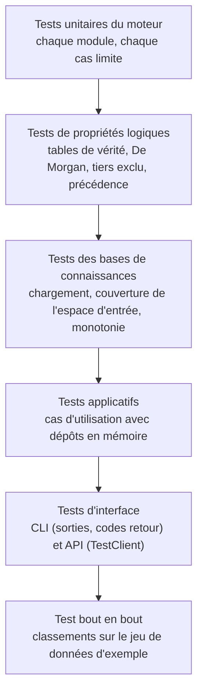

# 9. Qualité et tests

## 9.1 Stratégie

Les tests sont écrits **contre les abstractions** (un nouveau `Defuzzifier` ou une nouvelle
`MembershipFunction` est testable avec les mêmes fixtures) et **sans I/O réseau** ; les fichiers
temporaires passent par `tmp_path`.

## 9.2 Inventaire

| Fichier | Vérifie | Tests |
|---|---|---|
| `engine/test_membership.py` | Valeurs des six formes, bords verticaux, validations, registre/fabrique, `Universe` | 19 |
| `engine/test_operators.py` | **Réduction aux tables de vérité du cours** pour les 3 familles, commutativité, éléments neutres, De Morgan, **perte du tiers exclu**, implications, registres | 10 |
| `engine/test_formulas.py` | Vérité des connecteurs selon la famille, modificateurs, **rendu selon les règles de parenthésage du cours**, rendu français, énumération des atomes | 7 |
| `engine/test_dsl.py` | Lexer (FR/EN, accents, positions d'erreur), précédence, `N'EST PAS`/`IS NOT`, modificateurs, préfixe `REGLE`, conséquents multiples, 7 messages d'erreur | 16 |
| `engine/test_rules_and_variables.py` | Fuzzification, invariants des règles, doublons, **diagnostics de validation** | 6 |
| `engine/test_inference_and_defuzzification.py` | Centroïde/bissectrice/MOM sur formes symétriques et écrêtées, cas vide, fabrique, **forces d'activation et agrégation de Mamdani**, implication produit | 6 |
| `engine/test_system_and_pipeline.py` | Monotonie et libellés, bornage avec avertissement, entrées manquantes/NaN, aucune règle, erreurs de définition, **chaînage d'étapes**, explications | 10 |
| `engine/test_toml_loader.py` | Toutes les options, **bibliothèque partagée**, fichiers absents/invalides, 15 diagnostics, pipelines | 20 |
| `scouting/test_domain.py` | `Player` (attributs gelés), invariants, **raisons d'exclusion** des filtres | 4 |
| `scouting/test_csv_repository.py` | Conversion, cellules vides, erreurs ligne/colonne, `;` + BOM + virgule décimale, fichiers absents/vides | 8 |
| `scouting/test_knowledge.py` | Catalogue, chargement de chaque pipeline, **couverture de l'espace d'entrée (300 tirages × 5 postes)**, monotonie du score en fonction des buts | 4 |
| `scouting/test_use_cases.py` | Évaluation expliquée, candidat faible vs fort, erreurs, ad hoc, **classement/filtres/exclusions**, résumé des bases, **cohérence sur le jeu d'exemple** | 7 |
| `scouting/test_cli.py` | Chaque commande en texte et JSON, codes de retour 1 et 2 | 6 |
| `scouting/test_api.py` | Santé, référentiel, évaluations (200/404/422), ad hoc, classement, validation pydantic, **variables et courbes d'appartenance**, règles détaillées d'un poste, service de l'interface web | 6 |
| `irrigation/test_irrigation.py` | Décisions extrêmes, monotonie, validation des mesures, CLI unitaire/JSON/lot/erreur | 5 |
| `engine/test_robustness.py` | Singleton hors grille **signalé** (pas de valeur par défaut silencieuse), entrées non finies / non numériques, paramètres de forme non numériques, **pipeline mal ordonné refusé** | 11 |
| `scouting/test_robustness.py` | Cellules CSV `nan`/`inf` rejetées avec ligne et colonne, **repli Windows-1252**, répertoire au lieu de fichier, invariants `Player`, filtre de poste insensible à la casse, `--attr` dupliqué, `--json` sur `positions`/`validate`, **API 422** (nom vide, `NaN` dans le corps ou les filtres) | 12 |
| `irrigation/test_irrigation_cli_errors.py` | Lot CSV : colonne manquante, valeur invalide localisée (numéro de ligne) | 2 |
| **Total** | | **165** |

Exécution : `python -m pytest` (≈ 10 s). Couverture : **96 %** des lignes et branches de `src/`
(`python -m pytest --cov=src --cov-report=term-missing`). Les lignes non couvertes sont des
branches défensives (flux non reconfigurables, `serve` sans uvicorn) et des messages d'erreur
alternatifs.

## 9.3 Propriétés du cours vérifiées

| Propriété (page du cours) | Test |
|---|---|
| Tables de vérité de `∧`, `∨`, `¬` (p. 14-15) retrouvées sur `{0, 1}` | `test_restricted_to_binary_values_every_family_matches_the_classical_tables` |
| Commutativité, éléments neutres (p. 22-24) | `test_commutativity_and_neutral_elements` |
| Lois de De Morgan (p. 25) | `test_de_morgan_holds_for_zadeh_operators` |
| Tiers exclu (p. 24) — **perdu** en flou, conservé par Łukasiewicz | `test_excluded_middle_is_lost_in_fuzzy_logic` |
| Règles d'élimination des parenthèses (p. 13) | `test_rendering_follows_course_parenthesis_rules`, `test_precedence_not_over_and_over_or` |
| Définition récursive des fbf (p. 12) | structure de `test_formulas.py` et du parseur |
| Modus ponens / activation des règles (p. 44) | `test_mamdani_activation_strengths_and_aggregation` |
| Dérivation en chaîne (p. 33) | `test_pipeline_chains_outputs_into_inputs` |

## 9.4 Analyse statique

| Outil | Configuration | État |
|---|---|---|
| `ruff check` | E, F, W, I, N, UP, B, SIM, C4, RUF ; 100 colonnes | 0 avertissement |
| `ruff format` | formatage canonique | conforme |
| `mypy --strict` | `src/` entier, `warn_unreachable` | 0 erreur (59 fichiers) |

## 9.5 Intégration continue

`.github/workflows/ci.yml` exécute `ruff format --check`, `ruff check`, `mypy` et `pytest --cov`
sur Python 3.11, 3.12 et 3.13 (Ubuntu) et sur Python 3.13 (Windows), à chaque push et pull request.

## 9.6 Revue de code : liste de contrôle

- [ ] Toute nouvelle abstraction a au moins un test écrit contre l'interface.
- [ ] Toute nouvelle règle ou base passe `fuzzyscout validate` et le test de couverture.
- [ ] Aucune dépendance ajoutée au cœur `fuzzyengine`.
- [ ] Les messages d'erreur localisent la faute (fichier, règle, colonne).
- [ ] `make check` est vert ; `CHANGELOG.md` est mis à jour.
